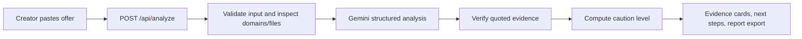

# Shieldio

**Check the deal. Protect your work.**

Shieldio helps creators inspect sponsorship messages for impersonation, risky downloads, payment traps and credential requests. It pairs deterministic domain and filename checks with Gemini interpretation, then gives quoted evidence and practical verification steps.

**ForgeHacks 2026 track: AI + Cybersecurity.**

## Problem and target users

Creators and freelancers receive brand outreach through email and DMs. An attractive offer can hide an account takeover attempt, an executable download or an upfront payment demand. Shieldio gives them a quick second opinion before they click, share account details or proceed with a deal.

## Features

- Paste an offer and optionally supply the sender, brand name and independently trusted brand website.
- Compare the sender and link hostnames against the supplied trusted domain, including real subdomain boundaries.
- Recognize executable and archive filenames without opening links or attachments.
- Ask Gemini for message-level concerns, exact supporting quotations, verification steps and a neutral draft reply.
- Discard AI findings whose quotations do not appear verbatim in the message.
- Show cautious, rule-derived labels rather than an invented probability of fraud.
- Copy or export the report as Markdown; copy a draft reply without sending it.
- Try three fictional examples, all analyzed through the live API.
- Responsive UI, accessible form labels, keyboard focus and reduced-motion support.

## Quick start

Requires Node.js 22. There are no runtime package dependencies.

1. Copy `.env.example` to `.env`.
2. Set `GEMINI_API_KEY` to your Gemini API key. Never put it in browser code or commit it.
3. Run `npm start`.
4. Open `http://localhost:3000`.

On a machine that uses a trusted corporate/system certificate store, start Node with `node --use-system-ca server.js`. Do not disable TLS verification.

Optional configuration: `GEMINI_MODEL` defaults to `gemini-2.5-flash`; `PORT` defaults to `3000`.

## Deploy on Vercel

1. Push this repository to GitHub and import it into Vercel.
2. Select **Other** as the framework preset. The tracked `vercel.json` configures `public` as the output directory and the Node function at `/api/analyze`.
3. Set `GEMINI_API_KEY` in Vercel's server environment variables. Optionally set `GEMINI_MODEL`.
4. Deploy. Check a sample offer after deployment.

There is no frontend build step or database. Static assets are in `public/`; the server function is `api/analyze.js`.

## Architecture

Gemini sees the submitted message and context, receives instructions to treat them as untrusted data, and returns structured JSON. Code validates quoted evidence and computes the displayed caution level from supported findings. A high concern triggers `HIGH CAUTION`; a medium concern triggers `VERIFY FIRST`; otherwise the UI says `FEW INDICATORS FOUND`. These labels are not calibrated probabilities.

## Validation

Run `npm test`. Tests cover deceptive domain suffixes, user-info URL deception, executable warnings, input limits and rejection of fabricated AI quotations. Test the three examples through the UI with a real configured key to verify end-to-end model behavior.

## Privacy and limitations

Shieldio does not persist submitted offers or reports. Input is sent to Google Gemini, so its service terms and data policies also apply. Remove personal information before submitting. API credentials stay on the server. Error responses do not expose credentials or provider responses.

This prototype does not verify email authentication, domain ownership, brand identity, reputation, attachment contents or destination pages. It cannot certify that an offer is safe or fraudulent. A third-party agency domain can be legitimate. Negation and context require AI interpretation, and AI can make mistakes. Exact-quote validation proves a quote exists; it does not prove the model's interpretation is correct. All sample brands and `.example` domains are fictional.

Requests are bounded by input size and timeouts. The included per-instance rate limit is best-effort and resets across serverless instances; use a shared rate limiter and provider spending controls before broader production use.

## Work created during the event

Shieldio's application source, UI, checks, tests and documentation were created during ForgeHacks on October 10, 2026. No previously developed project code was reused. Existing dependencies/services: Node.js, Gemini API, Vercel hosting and Google Fonts.

## Impact

The project helps creators recognize suspicious requests, understand the evidence and verify an offer through a trusted channel. Intended outcomes are fewer risky downloads, fewer shared account codes and better verification habits. No measured reduction in fraud is claimed.

## License

MIT — see `LICENSE`.
